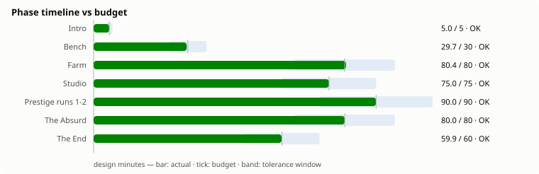
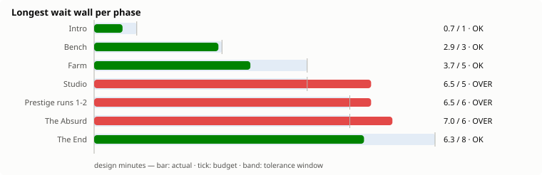
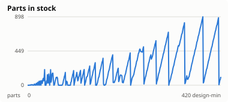
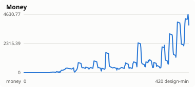
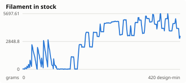
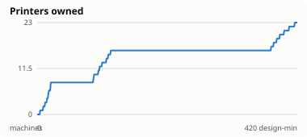
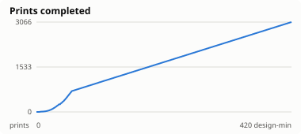

# Balance report — 2026-08-12

Reference bot: `balanced` · target 8 h · tolerance ±20 %

**PASS** — every phase inside its window, no wait wall over budget.

## Phase timeline

| Phase | Budget | idle | greedy-spender | balanced | idle-heavy |
|---|---|---|---|---|---|
| Intro | 5 (4–6) | 420.0 | 5.0 | 5.0 | 90.0 |
| Bench | 30 (24–36) | — | 30.4 | 29.7 | 150.0 |
| Farm | 80 (64–96) | — | 384.6 | 80.4 | 180.0 |
| Studio | 75 (60–90) | — | — | 75.0 | — |
| Prestige runs 1-2 | 90 (72–108) | — | — | 90.0 | — |
| The Absurd | 80 (64–96) | — | — | 80.0 | — |
| The End | 60 (48–72) | — | — | 59.9 | — |
| **Total** | **420** | **420.0** | **420.0** | **420.0** | **420.0** |

The reference run took 420.0 design-minutes (7.00 wall-hours at targetHours=8) and ended in `end`.

## Wait walls

A wait wall is a stretch with no meaningful action available — nothing to
attach, nothing affordable, no idle machine to feed (spec §12.2). Selling
parts does not count: it is a step towards a purchase, not a decision.

| Phase | Longest wall | Budget | Walls found |
|---|---|---|---|
| Intro | 0.7 | 1 | 8 |
| Bench | 2.9 | 3 | 16 |
| Farm | 4.0 | 5 | 35 |
| Studio | 4.0 | 5 | 26 |
| Prestige runs 1-2 | 4.0 | 6 | 27 |
| The Absurd | 4.0 | 6 | 24 |
| The End | 4.0 | 8 | 19 |

## Resource curves

Small multiples, one scale each — Parts and Money differ by orders of
magnitude and a shared axis would flatten one of them into the floor.

## Activity

| Bot | Decisions | Actions | Prints | Failed | Failure rate | Final phase |
|---|---|---|---|---|---|---|
| idle | 42 | 0 | 0 | 0 | — | intro |
| greedy-spender | 5040 | 963 | 26426 | 2627 | 9.0 % | farm |
| balanced | 5040 | 1036 | 3066 | 159 | 4.9 % | end |
| idle-heavy | 42 | 58 | 589 | 39 | 6.2 % | farm |

## Sweep

Attached as [`sweep.csv`](./sweep.csv).

---

Generated by `pnpm balance:report`.
