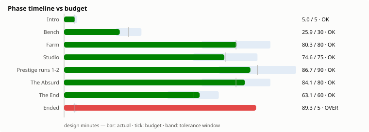
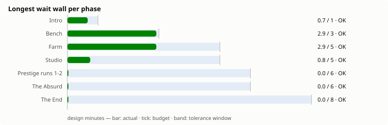
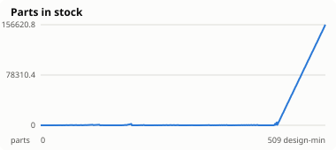
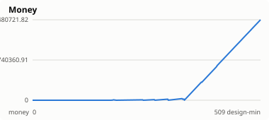
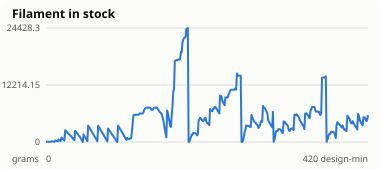
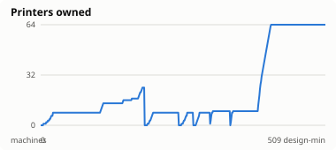
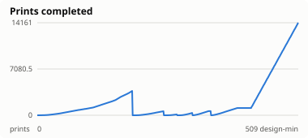

# Balance report — 2026-08-13

Reference bot: `balanced` · target 8 h · tolerance ±20 %

**PASS** — every phase inside its window, no wait wall over budget.

## Phase timeline

| Phase | Budget | idle | greedy-spender | balanced | idle-heavy |
|---|---|---|---|---|---|
| Intro | 5 (4–6) | 510.0 | 5.0 | 5.0 | 90.0 |
| Bench | 30 (24–36) | — | 22.9 | 25.9 | 140.0 |
| Farm | 80 (64–96) | — | 79.7 | 80.3 | 280.0 |
| Studio | 75 (60–90) | — | 74.2 | 74.6 | — |
| Prestige runs 1-2 | 90 (72–108) | — | 29.0 | 86.7 | — |
| The Absurd | 80 (64–96) | — | 192.6 | 84.1 | — |
| The End | 60 (48–72) | — | 105.6 | 63.1 | — |
| Ended | sandbox | — | — | 89.3 | — |
| **Total (the arc)** | **420** | **510.0** | **509.0** | **419.7** | **510.0** |

The reference run took 509.0 design-minutes (8.48 wall-hours at targetHours=8) and ended in `ended`.

## Wait walls

A wait wall is a stretch with no meaningful action available — nothing to
attach, nothing affordable, no idle machine to feed (spec §12.2). Selling
parts does not count: it is a step towards a purchase, not a decision.

| Phase | Longest wall | Budget | Walls found |
|---|---|---|---|
| Intro | 0.7 | 1 | 8 |
| Bench | 2.9 | 3 | 13 |
| Farm | 2.9 | 5 | 96 |
| Studio | 0.8 | 5 | 149 |
| Prestige runs 1-2 | 0.0 | 6 | 0 |
| The Absurd | 0.0 | 6 | 0 |
| The End | 0.0 | 8 | 0 |
| Ended | 0.0 | 60 | 0 |

## Resource curves

Small multiples, one scale each — Parts and Money differ by orders of
magnitude and a shared axis would flatten one of them into the floor.

## Activity

| Bot | Decisions | Actions | Prints | Failed | Failure rate | Final phase |
|---|---|---|---|---|---|---|
| idle | 51 | 0 | 0 | 0 | — | intro |
| greedy-spender | 6108 | 765 | 1489 | 96 | 6.1 % | end |
| balanced | 6108 | 1673 | 14161 | 1400 | 9.0 % | ended |
| idle-heavy | 51 | 96 | 2076 | 198 | 8.7 % | farm |

---

Generated by `pnpm balance:report`.
