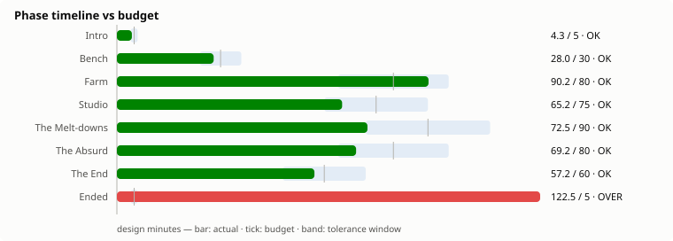
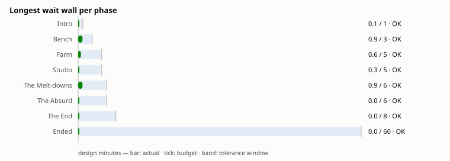
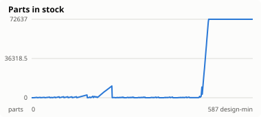
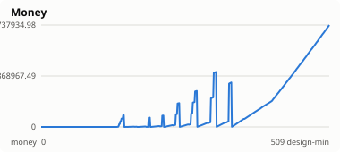
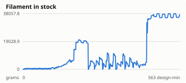
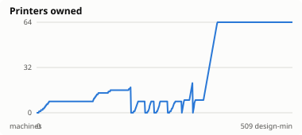
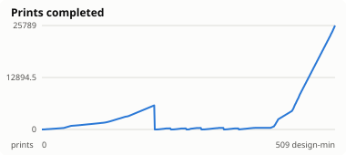

# Balance report — 2026-10-27

Reference bot: `balanced` · target 8 h · tolerance ±20 %

**PASS** — every phase inside its window, no wait wall over budget.

## Phase timeline

| Phase | Budget | idle | greedy-spender | balanced | idle-heavy |
|---|---|---|---|---|---|
| Intro | 5 (4–6) | 510.0 | 4.3 | 4.3 | 90.0 |
| Bench | 30 (24–36) | — | 27.1 | 28.0 | 170.0 |
| Farm | 80 (64–96) | — | 80.7 | 90.2 | 250.0 |
| Studio | 75 (60–90) | — | 64.3 | 65.2 | — |
| The Melt-downs | 90 (72–108) | — | 85.4 | 72.5 | — |
| The Absurd | 80 (64–96) | — | 86.0 | 69.2 | — |
| The End | 60 (48–72) | — | 59.2 | 57.2 | — |
| Ended | sandbox | — | 102.1 | 122.5 | — |
| **Total (the arc)** | **420** | **510.0** | **406.9** | **386.5** | **510.0** |

The reference run took 509.0 design-minutes (8.48 wall-hours at targetHours=8) and ended in `ended`.

## Wait walls

A wait wall is a stretch with no meaningful action available — nothing to
attach, nothing affordable, no idle machine to feed (spec §12.2). Selling
parts does not count: it is a step towards a purchase, not a decision.

| Phase | Longest wall | Budget | Walls found |
|---|---|---|---|
| Intro | 0.6 | 1 | 8 |
| Bench | 0.9 | 3 | 28 |
| Farm | 0.6 | 5 | 153 |
| Studio | 0.3 | 5 | 43 |
| The Melt-downs | 0.8 | 6 | 4 |
| The Absurd | 0.0 | 6 | 0 |
| The End | 0.0 | 8 | 0 |
| Ended | 0.0 | 60 | 0 |

## Resource curves

Small multiples, one scale each — Parts and Money differ by orders of
magnitude and a shared axis would flatten one of them into the floor.

## Fun signals

The budgets above say whether the game is the right length. These say
whether the minutes are any good (see `tools/balance/src/fun.ts`). A
*drought* is the longest stretch in a phase with nothing new: no new
upgrade, machine, material, design, branch or phase. *Chores* are upkeep
actions (sell, recycle, restock, reload) as a share of all actions. Bots
are not players: read these as where to look, not as verdicts.

| Bot | Chores | Most repeated | Intro | Bench | Farm | Studio | The Melt-downs | The Absurd | The End |
|---|---|---|---|---|---|---|---|---|---|
| greedy-spender | 70 % | SET_SLOT_CONFIG ×588 | 4 | 22 | 15 | 27 | 54 | 39 | 51 |
| balanced | 70 % | SET_SLOT_CONFIG ×593 | 4 | 23 | 17 | 27 | 44 | 29 | 51 |
| idle-heavy | 73 % | SELL_PARTS ×16 | 70 | 120 | 180 | — | — | — | — |

Never bought by any bot: `pallet-printer`, `central-bank`.

Build-order divergence, `greedy-spender` vs `balanced`: 0.03 (0 = the same order, ~0.5 = unrelated).
Build-order divergence, `greedy-spender` vs `idle-heavy`: 0.00 (0 = the same order, ~0.5 = unrelated).

## Activity

| Bot | Decisions | Actions | Prints | Failed | Failure rate | Final phase |
|---|---|---|---|---|---|---|
| idle | 51 | 0 | 0 | 0 | — | intro |
| greedy-spender | 6108 | 2486 | 68537 | 9838 | 12.6 % | ended |
| balanced | 6108 | 2140 | 80597 | 11411 | 12.4 % | ended |
| idle-heavy | 51 | 75 | 1977 | 172 | 8.0 % | farm |

---

Generated by `pnpm balance:report`.
